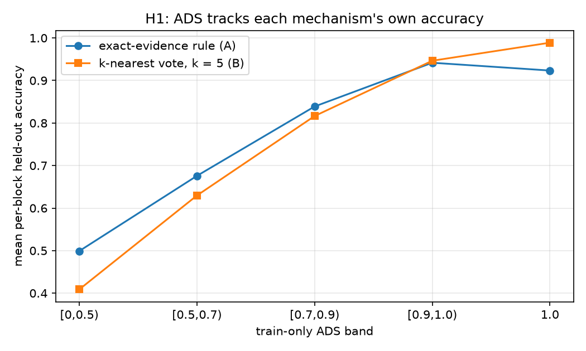
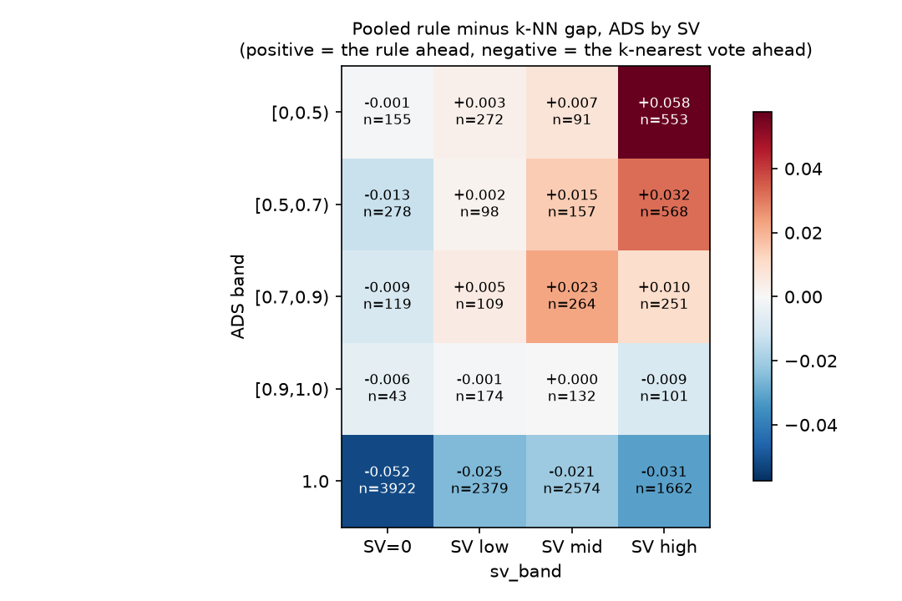

# Prediction is not selection

**A pre-registered study of design-time mechanism choice in author name disambiguation**

By Maitreya Sapariya · [ORCID 0009-0003-9346-3775](https://orcid.org/0009-0003-9346-3775)

[](https://doi.org/10.5281/zenodo.24184394)

[](phase2/PREREG.md)
[](phase2/reports/phase2_9c_cold_run.md)


> You hold a history of author mentions that are already resolved, and new ones keep arriving. Before you build anything, can you measure that history and know which resolver to build?
>
> On seven public benchmarks, mostly no. The data tells you how hard each name is. It does not tell you which mechanism will win.

## The result in two pictures

<table>
<tr>
<td width="50%"></td>
<td width="50%"></td>
</tr>
<tr>
<td><b>Prediction works.</b> Consistency tracks each mechanism's own accuracy, at Spearman 0.51 for the rule and 0.83 for the vote.</td>
<td><b>Selection does not.</b> Across all 20 cells of consistency by surface variability, no cell has a decided winner at the pre-registered five-point margin.</td>
</tr>
</table>

## The question

Every record-linkage or disambiguation system starts with a labelled history and no labels for the future. A designer can measure the history, but cannot yet score decisions that have not been made. This study asks whether two properties that are visible at design time can choose the mechanism for you:

- **Consistency (ADS):** the share of a name block's history held by its most frequent author. A value of 1.0 means the name has only ever meant one person.
- **Surface variability (SV):** how differently one person's name tends to be written, measured as the expected normalized edit distance between two mentions in the block.

The two mechanisms are deliberately simple and untrained, so that nothing but the data can decide between them:

| | Exact-evidence rule | k-nearest vote |
|---|---|---|
| Assigns when | the mention's exact name form already appears in the block's history | always, by a vote among the 5 most similar earlier mentions (normalized Levenshtein) |
| Otherwise | abstains | never abstains |
| Leans toward | precision | coverage |

## What the study found

1. **One common comparison is decided before it starts.** An exact-match rule is a strict sub-case of a retriever that assigns from the single nearest name form, whenever the similarity gives its maximum only to identical strings: a string already in the history is its own nearest neighbour. In the comparison most practitioners would run, the rule therefore cannot win at any cutoff. We measured zero rule wins on 199,713 held-out mentions in two metric families before we understood why.
2. **On a fair pair, the pooled contest is a near tie.** With the rule against a k-nearest vote, where neither mechanism contains the other, the two score 0.8244 and 0.8294 pooled over seven datasets. No consistency band and no variability band clears the margin fixed in advance, so both selection hypotheses return Inconclusive.
3. **The pool hides two datasets that go opposite ways.** kisti favours the rule by 0.1131 [+0.1015, +0.1250] through better matching. zbmath favours the vote by 0.0631 [−0.0761, −0.0512], because the rule abstains. A third dataset, inspire, holds 11,110 of the 13,902 blocks and dominates the pooled number.
4. **The one signal that decides anything was not on our list.** Block size, which we did not pre-register, carries decided verdicts, with the vote ahead on the smallest blocks. It works through the rule's abstentions, not through better matching.
5. **A real contest is rarer than it looks.** A two-sided contest, in which either mechanism can beat the other, is possible only where a name's history is both mixed and written in more than one way. That covers 42.2% of held-out mentions.

## What this means if you build resolvers

- If your fuzzy matcher's similarity peaks only on identical strings, it already contains the exact rule. Choosing between them is then a choice about coverage, not about who matches better.
- Consistency is a good difficulty meter. Use it to predict where errors will fall, not to pick the mechanism.
- To choose, compare the two once on a held-out slice of the same labelled history you would compute the signals from. It costs one run and stays at design time.

## Check it yourself

A negative result is easy to doubt, so every step behind this one can be checked.

- **Pre-registered.** The hypotheses, margins and analysis were frozen in [`phase2/PREREG.md`](phase2/PREREG.md) at commit `8869b82`, before any accuracy existed. The amendment and addendum (`5f452ad`, `3e79a48`) came before the reported run (`9e3d921`). Every hash the paper cites resolves in this repository.
- **Candid about its own record.** Section 6.4 of the paper lists each point where the record falls short of a clean pre-registration, including two rules inserted nine hours after the freeze.
- **Reproduced cold.** A fresh clone on a two-core laptop regenerated all 108 output files with identical content in 19 minutes ([cold-run report](phase2/reports/phase2_9c_cold_run.md)).
- **Checked number by number.** An independent pass traced the 829 numbers in the PDF to committed tables, or to arithmetic on them. The two it could not match were corrected before release ([ledger](phase2/reports/tables/phase2_9d_number_ledger.csv), [verifier report](phase2/reports/phase2_9d_verifier.md)).
- **Open about its tools.** The work was done with an AI assistant (Claude, Anthropic) under the author's direction. The paper's disclosure and the [pass log](phase2/PASSLOG.md) record how.

## Read it your way

| You have | Start here |
|---|---|
| Two minutes | This page |
| Twenty minutes | The abstract, section 1 and section 7 of the [paper](phase2/paper/main.pdf) |
| An afternoon | Reproduce it with [`phase2/README.md`](phase2/README.md) |
| A reviewer's eye | [`PREREG.md`](phase2/PREREG.md), the [pass log](phase2/PASSLOG.md) and the [errata](phase2/ERRATA.md) |

## Reproduce it

```bash
git clone https://github.com/stiFFLer-codes/prediction-is-not-selection
cd prediction-is-not-selection
python3.14 -m venv .venv && source .venv/bin/activate   # Windows: py -3.14 -m venv .venv, then .venv\Scripts\activate
pip install -r phase2/requirements-lock.txt
```

Then follow the nine-step run order in [`phase2/README.md`](phase2/README.md). The whole run takes about twenty minutes on a laptop, on the CPU alone, with no GPU and no paid service. The derived S2AND tables are in the repository, so the main run needs no download.

## What is in the repository

```
phase2/
├── README.md         the technical guide: environment, run order, expected outputs
├── paper/            the manuscript: main.tex, main.pdf, figures, bibliography
├── PREREG.md         the frozen pre-registration and its amendments
├── *.py              every script in the run order
├── data/             derived S2AND tables, a WDC extract and checksummed manifests
├── reports/          every table, figure and report the paper draws on
├── PASSLOG.md        a log of every pass over the work
├── ERRATA.md         corrections to the project's own records
└── DATA_LICENSES.md  which data is redistributed, and under which terms
```

## Cite

```bibtex
@misc{sapariya2026prediction,
  author    = {Sapariya, Maitreya},
  title     = {Prediction is not selection: a pre-registered study of design-time mechanism choice in author name disambiguation},
  year      = {2026},
  publisher = {Zenodo},
  doi       = {10.5281/zenodo.24184394},
  note      = {Preprint, not peer reviewed}
}
```

Or use [`CITATION.cff`](CITATION.cff).

## Licences

- Code: MIT ([`LICENSE`](LICENSE)).
- Paper, reports and documentation: CC BY 4.0 ([`LICENSE-TEXT`](LICENSE-TEXT)).
- Derived data: the terms of each source, set out in [`phase2/DATA_LICENSES.md`](phase2/DATA_LICENSES.md).

## Earlier work

This repository was earlier named ADS-Cascade. The tags `v1.0.0` and `v1.1.0` hold that work, which is deprecated and kept for the record only.
