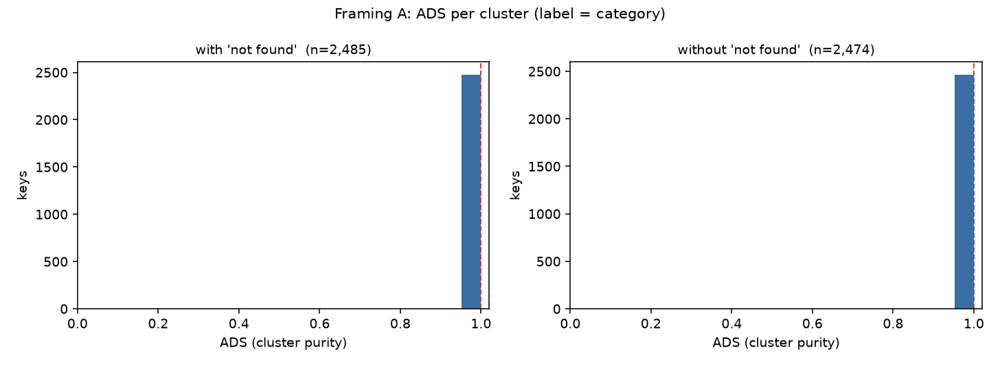
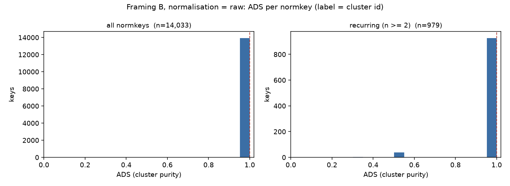
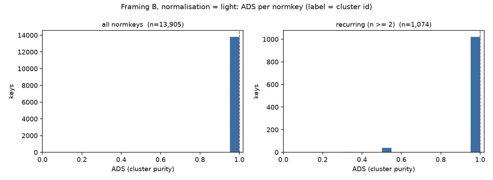
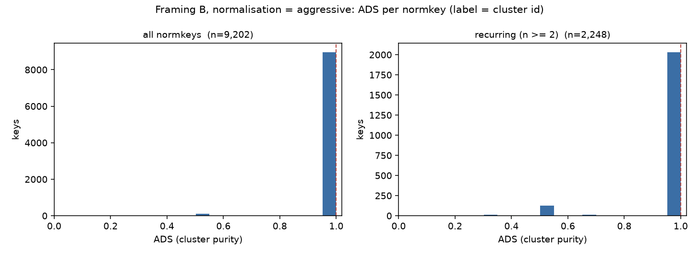
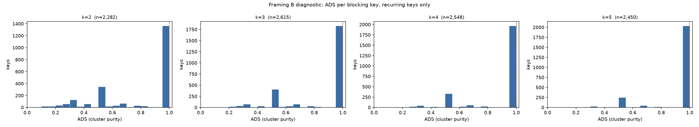

# Gate 2 ADS-range check (hard gate)

Table: `data/wdc_lspc2017_offers.csv.gz` — 15,179 offers, 2,485 clusters.

ADS = cluster purity: for a key, the share of that key's offers falling
in its single most common label.

**Scope note.** ADS is computed here over the full ingested subset, not
the train split. This pass asks whether the ADS axis has usable range at
all, which is a property of the corpus. The charter's design-time,
history-only ADS computed on the train split only is a gate 3 concern and
will be recomputed there.

No mechanisms, accuracy, thresholds, selector or cutoff were computed.

## Step 1 — discriminating check for Framing A

Does category actually vary within a cluster? If not, per-cluster
category purity is 1.0 by construction and the Framing A ADS axis has no
range at all.

- Clusters: 2,485
- Clusters with more than one distinct category: **0 (0.000%)**

Distribution of distinct categories per cluster:

| distinct categories | clusters | share |
| --- | --- | --- |
| 1 | 2,485 | 100.0% |

**Verdict: Framing A is dead.**

Category is not merely near-constant within clusters, it is exactly
constant in every one of them. This is structural, not a property of
this sample: WDC assigns a category at the cluster level and stamps it
onto each offer, so `category` is a function of `cluster_id`. ADS_A is
therefore a point mass at 1.0 for every cluster, with zero variance and
nothing to correlate against. Spec section 3 anticipated this outcome
and it is confirmed. Framing A is not carried forward.

## Step 2 — Framing A (key = cluster id, label = per-offer category)

### with 'not found'

- Keys: 2,485
- Keys with more than one distinct label: 0.000%
- Fraction at exactly ADS = 1.0 (the spike): **100.000%**
- min 1.000, median 1.000, mean 1.000, max 1.000

| band | keys | share |
| --- | --- | --- |
| [0.0, 0.5) | 0 | 0.0% |
| [0.5, 0.7) | 0 | 0.0% |
| [0.7, 0.9) | 0 | 0.0% |
| [0.9, 1.0) | 0 | 0.0% |
| 1.0 exactly | 2,485 | 100.0% |

### without 'not found'

- Keys: 2,474
- Keys with more than one distinct label: 0.000%
- Fraction at exactly ADS = 1.0 (the spike): **100.000%**
- min 1.000, median 1.000, mean 1.000, max 1.000

| band | keys | share |
| --- | --- | --- |
| [0.0, 0.5) | 0 | 0.0% |
| [0.5, 0.7) | 0 | 0.0% |
| [0.7, 0.9) | 0 | 0.0% |
| [0.9, 1.0) | 0 | 0.0% |
| 1.0 exactly | 2,474 | 100.0% |

The `not found` category covers 53 offers in 11 clusters. Because category is cluster-constant, `not found` is a whole-cluster label, so excluding it removes those clusters wholesale rather than splitting any cluster. Both views are reported above and neither changes the verdict.

The histogram is a single bar at 1.0 in both views. There is no axis here.

## Step 3 — Framing B (key = normalized surface string, label = cluster id)

Three normalisation strengths, defined in `gate2_ads_range.py`:

| strength | definition |
| --- | --- |
| `raw` | surface string exactly as distributed |
| `light` | strip lang tags, Null, punctuation; lowercase |
| `aggressive` | light + first quoted segment only + token sort/dedupe |

The `aggressive` rule is data-driven rather than guessed: every title in
this corpus is a sequence of double-quoted segments, and the first is the
offer title proper while later ones are page-title and retailer
boilerplate (see step 4). `aggressive` keeps only that first segment.

Each strength is reported over two views. **All normkeys** is the
population as asked. **Recurring normkeys (n >= 2)** drops singletons,
which are pinned to ADS = 1.0 arithmetically rather than informatively;
this is the view that actually shows whether the axis has range.

### `raw`

- Distinct normkeys: 14,033 (from 15,179 offers); recurring (n >= 2): 979
- Normkeys mapping to more than one cluster: **0.349%** of all normkeys, **5.005%** of recurring normkeys

**All normkeys** — n = 14,033; spike at 1.0 = 13,984 (99.651%); min 0.200, median 1.000, mean 0.998, max 1.000

| band | keys | share |
| --- | --- | --- |
| [0.0, 0.5) | 7 | 0.0% |
| [0.5, 0.7) | 42 | 0.3% |
| [0.7, 0.9) | 0 | 0.0% |
| [0.9, 1.0) | 0 | 0.0% |
| 1.0 exactly | 13,984 | 99.7% |

**Recurring normkeys (n >= 2)** — n = 979; spike at 1.0 = 930 (94.995%); min 0.200, median 1.000, mean 0.974, max 1.000

| band | keys | share |
| --- | --- | --- |
| [0.0, 0.5) | 7 | 0.7% |
| [0.5, 0.7) | 42 | 4.3% |
| [0.7, 0.9) | 0 | 0.0% |
| [0.9, 1.0) | 0 | 0.0% |
| 1.0 exactly | 930 | 95.0% |

### `light`

- Distinct normkeys: 13,905 (from 15,179 offers); recurring (n >= 2): 1,074
- Normkeys mapping to more than one cluster: **0.352%** of all normkeys, **4.562%** of recurring normkeys

**All normkeys** — n = 13,905; spike at 1.0 = 13,856 (99.648%); min 0.200, median 1.000, mean 0.998, max 1.000

| band | keys | share |
| --- | --- | --- |
| [0.0, 0.5) | 7 | 0.1% |
| [0.5, 0.7) | 42 | 0.3% |
| [0.7, 0.9) | 0 | 0.0% |
| [0.9, 1.0) | 0 | 0.0% |
| 1.0 exactly | 13,856 | 99.6% |

**Recurring normkeys (n >= 2)** — n = 1,074; spike at 1.0 = 1,025 (95.438%); min 0.200, median 1.000, mean 0.976, max 1.000

| band | keys | share |
| --- | --- | --- |
| [0.0, 0.5) | 7 | 0.7% |
| [0.5, 0.7) | 42 | 3.9% |
| [0.7, 0.9) | 0 | 0.0% |
| [0.9, 1.0) | 0 | 0.0% |
| 1.0 exactly | 1,025 | 95.4% |

### `aggressive`

(86 offers normalised to an empty string, dropped.)

- Distinct normkeys: 9,202 (from 15,093 offers); recurring (n >= 2): 2,248
- Normkeys mapping to more than one cluster: **2.271%** of all normkeys, **9.297%** of recurring normkeys

**All normkeys** — n = 9,202; spike at 1.0 = 8,993 (97.729%); min 0.049, median 1.000, mean 0.988, max 1.000

| band | keys | share |
| --- | --- | --- |
| [0.0, 0.5) | 43 | 0.5% |
| [0.5, 0.7) | 155 | 1.7% |
| [0.7, 0.9) | 10 | 0.1% |
| [0.9, 1.0) | 1 | 0.0% |
| 1.0 exactly | 8,993 | 97.7% |

**Recurring normkeys (n >= 2)** — n = 2,248; spike at 1.0 = 2,039 (90.703%); min 0.049, median 1.000, mean 0.953, max 1.000

| band | keys | share |
| --- | --- | --- |
| [0.0, 0.5) | 43 | 1.9% |
| [0.5, 0.7) | 155 | 6.9% |
| [0.7, 0.9) | 10 | 0.4% |
| [0.9, 1.0) | 1 | 0.0% |
| 1.0 exactly | 2,039 | 90.7% |

### Framing B at a glance

| strength | normkeys | recurring | impure (all) | impure (recurring) | spike@1.0 (recurring) | median (recurring) | mean (recurring) |
| --- | --- | --- | --- | --- | --- | --- | --- |
| `raw` | 14,033 | 979 | 0.35% | 5.01% | 95.0% | 1.000 | 0.974 |
| `light` | 13,905 | 1,074 | 0.35% | 4.56% | 95.4% | 1.000 | 0.976 |
| `aggressive` | 9,202 | 2,248 | 2.27% | 9.30% | 90.7% | 1.000 | 0.953 |

### Step 3b — coarser blocking keys (exploratory diagnostic)

All three strengths above key on the whole normalized title, which is
near-unique per offer, so ADS_B is pinned to 1.0 by arithmetic rather than
by any property of the data. Spec section 3 defines Framing B's key as "a
normalized surface **or blocking key**", so this probes the second option:
`blocking-k` keys on the first k tokens of the `aggressive` normkey.

Because `aggressive` token-sorts, "first k tokens" means the
alphabetically-first k tokens. That is deterministic and reproducible but
it is not a principled blocking function; a brand-plus-model-number key is
the version worth designing properly. Treat these numbers as evidence that
the axis responds to key granularity, not as a proposed key.

**This is a diagnostic. No framing is committed here.**

| k | normkeys | recurring | impure (recurring) | spike@1.0 | median | mean | in (0.5, 1.0) |
| --- | --- | --- | --- | --- | --- | --- | --- |
| 2 | 4,746 | 2,282 | 40.1% | 59.9% | 1.000 | 0.784 | 9.6% |
| 3 | 6,837 | 2,615 | 29.9% | 70.1% | 1.000 | 0.850 | 7.3% |
| 4 | 7,909 | 2,548 | 22.7% | 77.3% | 1.000 | 0.890 | 5.8% |
| 5 | 8,487 | 2,450 | 16.7% | 83.3% | 1.000 | 0.919 | 4.0% |

The axis responds strongly and monotonically to key granularity. At k = 2
the spike at 1.0 falls to about 60% and the mean to about 0.78, with mass
spread across the interior of the range. This is the first view in this
pass that looks like a distribution rather than a point mass.

## Step 4 — surface-noise characterization (light)

Heuristics, not a study. Language is read off the `"@lang` tags the WDC
serialisation already carries, which is direct evidence where present;
untagged titles are simply unknown, so the non-English share below is a
lower bound.

- Titles carrying at least one explicit language tag: 59.4%
- Titles carrying at least one **non-English** language tag: **26.1%** (lower bound; of tagged titles, 44.0%)
- Titles containing non-ASCII characters: 16.1% (weak secondary signal)
- Titles with more than one quoted segment, i.e. carrying a page-title / retailer segment after the offer title: **55.4%**
- Titles matching an observed retailer-boilerplate marker: **50.7%**
- Titles containing a `Null` literal: 5.8%

Top language tags by offer count:

| tag | offers |
| --- | --- |
| `en` | 7,941 |
| `es` | 2,008 |
| `en-US` | 1,374 |
| `de` | 967 |
| `fr` | 921 |
| `NL` | 746 |
| `it` | 718 |
| `pl` | 655 |
| `nl` | 250 |
| `en-GB` | 161 |
| `nl-NL` | 134 |
| `pt` | 99 |

## Step 5 — recommendation

**Framing A: dead, conclusively.** Not near-degenerate, exactly
degenerate. Category is a function of cluster id in this corpus, so ADS_A
is 1.0 for all 2,485 clusters with zero variance. No normalisation, subset
or label-handling choice can change this, because it is a property of how
WDC assigns categories rather than of the sample. Do not carry it forward.

**Framing B as literally specified: also effectively dead.** Keying on the
whole normalized title makes the key almost as unique as the offer itself.
Even at the `aggressive` strength only 8,139 of 15,093 offers (53.9%) sit under a normkey
that recurs at all, and among recurring normkeys the spike at ADS = 1.0 is
still 90.7%. Worse, the non-spike mass is not spread: it is concentrated on
a handful of small-denominator values (0.5 dominates, then 0.667), because
a recurring normkey has a median of 2 offers. That is not a continuous axis
with usable range; it is a near-binary pure/ambiguous flag with a base rate
around 9%. Charter invariant 1 says do not proceed on a dead axis, and on
these histograms this version of the axis is dead.

**But the axis is not dead in principle, it is dead at this key
granularity.** Step 3b shows ADS responds strongly and monotonically to how
coarse the key is. At k = 2 the spike falls to about 60%, roughly 40% of
recurring keys are impure, and the mass genuinely spreads across the range.
Spec section 3 already permits this reading: Framing B's key is "a
normalized surface **or blocking key**", and everything measured in steps
1 to 3 tested only the first option.

### What I would take forward, for review

Framing B with a **blocking key**, not a whole-title normkey. Concretely,
gate 3 would need a principled blocking function designed and frozen
before anything downstream is built: brand token plus model-number token is
the obvious candidate for this corpus, with the step 3b first-k-tokens keys
as a crude fallback. The reason to prefer it over the alternatives:

1. It is the only variant measured in this pass that produces a real
   distribution rather than a point mass, which is what invariant 1 asks for.
2. It preserves the scientific story. A blocking key that resolves to one
   cluster versus several is exactly the "generic or ambiguous strings
   resolve to multiple clusters" mechanism spec section 3 describes, and it
   keeps ADS and surface stability as genuinely separate axes, so invariant
   2 is not at risk.
3. It costs nothing already spent. The ingested table is unchanged; only the
   key derivation changes.

### Caveats the reviewer should weigh

- The blocking key must be frozen before gate 3 measures anything, or the
  ADS range becomes a tuned quantity and invariant 5 is compromised. Step 3b
  deliberately stops at characterisation for this reason.
- Coarsening the key trades range for meaning. A k = 2 key is close to a
  brand-level bucket, and "this brand resolves to many products" is a
  weaker notion of decision consistency than the paper wants. A brand plus
  model-number key should be checked to confirm it keeps the range without
  collapsing into brand frequency.
- Volume is a live risk. 15,179 offers supports characterisation but may be
  thin once split for held-out evaluation under invariant 3. The per-category
  offers corpus is the upgrade path if gate 3 needs more.
- Roughly half these titles carry retailer boilerplate and at least 26% are
  non-English (step 4), so normalisation choices move the numbers materially.
  Whatever is chosen must be frozen and reported, not tuned.

**No framing is committed and nothing downstream is built. Stopping for
review as the hard gate requires.**

